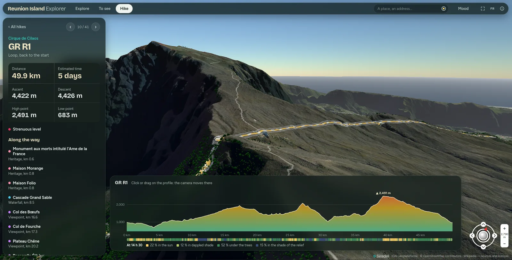

# Reunion Island Explorer — hiking trails of La Réunion in 3D

An experimental **3D digital twin of Reunion Island** (La Réunion) and its hiking
trails, in English and French. Fly over the volcanoes and cirques, then follow the
trails in 3D, right in the browser.

[](https://oss.siradel.com/horizon-demo-reunion-island/)

**[▶ Live demo](https://oss.siradel.com/horizon-demo-reunion-island/)**

## Features

- 3D relief, aerial imagery and buildings of the whole island, with an opening
  dive from space
- 41 hiking trails from OpenStreetMap with distance, ascent, walking time, level
  and elevation profile
- Drone flyover of every trail
- Real trees along the trails, detected in the IGN LiDAR HD survey (desktop only: phones get a lighter profile without trees or shadows)
- Sun / shade strip: where the trail is in the sun at a given time of day
- Places worth seeing with Wikipedia excerpts, place search, four light
  ambiances

## Built with Horizon

Reunion Island Explorer is a demo of
[Horizon](https://github.com/siradel-oss/horizon), Siradel's open source real-time
3D engine for map data on a globe (WebAssembly, WebGL 2, TypeScript). It shows
terrain and imagery streaming, PMTiles vector layers, instanced glTF models
(trees), camera flights and dynamic sun lighting, without any UI framework.

- Horizon: [website and documentation](https://horizon.oss.siradel.com) ·
  [getting started](https://horizon.oss.siradel.com/doc/getting_started.html) ·
  npm packages `@siradel-oss/horizon-{api,core,protocol}`
- More Horizon demos:
  [IGN Explorer](https://github.com/siradel-oss/horizon-demo-ign-geoplateforme)
  (IGN Géoplateforme catalogue in 3D) ·
  [Shoreline Explorer](https://github.com/siradel-oss/horizon-demo-coastline-erosion)
  (coastal erosion in France)

> **A demonstrator.** Horizon grew out of the [SCE](https://sce.oss.siradel.com)
> ecosystem. Reunion Island Explorer is still an experiment: the data processing
> may contain errors, and trail
> times, levels and routes are indicative only. **Do not use it to plan or follow
> a hike**; check trail closures with the
> [ONF](https://www.onf.fr/vivre-la-foret/+/b90::randonnee-la-reunion-connaitre-les-sentiers-fermes.html)
> and the weather before setting off.

## En français

Reunion Island Explorer est un jumeau numérique 3D expérimental de **l'île de La
Réunion** et de ses **sentiers de randonnée** : relief, orthophotos et bâtiments,
41 randonnées avec profil altimétrique, survol en drone, arbres issus du LiDAR HD
de l'IGN et bande soleil / ombre. Démonstrateur du moteur 3D open source Horizon,
interface en français et en anglais. À ne pas utiliser pour préparer une
randonnée.

## Run it

Requirements: Node.js ≥ 22.12, pnpm ≥ 10, and a browser with WebGL 2 and
`SharedArrayBuffer`.

```bash
pnpm install
pnpm dev        # http://localhost:5173
```

| Command        | Description               |
| -------------- | ------------------------- |
| `pnpm dev`     | Development server        |
| `pnpm build`   | Static build into `dist/` |
| `pnpm preview` | Serves the build locally  |

The build uses relative URLs (Vite base `./`), so `dist/` can be served under
any subpath.

URL parameters, handy for demos:

| Parameter                         | Effect                               |
| --------------------------------- | ------------------------------------ |
| `?lang=en\|fr`                    | interface language                   |
| `?intro=0`                        | skips the opening dive from space    |
| `?ambiance=aube\|midi\|brume\|doree` | starting light (`doree` by default) |

### Serving requirements

Horizon runs its WASM core across threads, which requires `SharedArrayBuffer`.
The static server must therefore send these headers on every response:

```
Cross-Origin-Opener-Policy: same-origin
Cross-Origin-Embedder-Policy: credentialless
```

`credentialless` rather than `require-corp`: the IGN tiles do not send a
`Cross-Origin-Resource-Policy` header and would be blocked. The server must also
serve `hrz_core.wasm` as `application/wasm` and accept HTTP `Range` requests
(PMTiles). The dev and preview servers already do all of this (see
`vite.config.ts`).

Hosts that cannot set headers, such as GitHub Pages, rely on the bundled
[coi-serviceworker](https://github.com/gzuidhof/coi-serviceworker) (MIT), which adds
them client-side. The `.github/workflows/deploy.yml` workflow builds and publishes
the app to GitHub Pages on every push to `main`.

## Stack

- [Horizon](https://horizon.oss.siradel.com): `@siradel-oss/horizon-{api,core,protocol}`
- TypeScript and the DOM, no framework; Vite 7
- Fonts bundled from Fontsource (no third-party font requests)

```
src/
├── main.ts           # Wiring: boot, opening flight, tabs, selection, hover
├── i18n.ts           # EN/FR; strings sit next to their component as { en, fr }
├── engine/           # Horizon: layers, scene and camera, overlays, trees, flyover
├── data/             # Catalogues (trails, places, sun), IGN geocoding
└── ui/               # Panels, profile, navigation widget, about dialog
public/data/          # Pre-generated PMTiles and JSON catalogues
public/models/        # Tree models (glTF)
```

## Data

Open data only. The files in `public/data/` were generated from the sources
below; the IGN imagery, elevation and buildings are streamed at runtime.

| Producer           | Datasets                                                                                                                         | Licence                                                               |
| ------------------ | -------------------------------------------------------------------------------------------------------------------------------- | --------------------------------------------------------------------- |
| IGN, Géoplateforme | BD ORTHO® imagery, RGE ALTI® elevation, BD TOPO® buildings and vegetation, LiDAR HD canopy height, geocoding and altimetry services | [Licence Ouverte 2.0](https://www.etalab.gouv.fr/licence-ouverte-open-licence/) |
| OpenStreetMap      | Hiking routes (`route=hiking` relations) and points of interest                                                                  | [ODbL 1.0](https://www.openstreetmap.org/copyright)                   |
| Wikipedia          | Excerpts of articles describing places (mostly French Wikipedia)                                                                 | [CC BY-SA 4.0](https://creativecommons.org/licenses/by-sa/4.0/)       |

`trails.json`, `trails.pmtiles`, `pois.json` and `pois.pmtiles` contain data
© OpenStreetMap contributors and are a derivative database distributed under the
[Open Database License](https://opendatacommons.org/licenses/odbl/1-0/).
The Wikipedia excerpts in `pois.json` remain under CC BY-SA 4.0; each one links to
its source article in the app.

**Derived information.** Several values are computed by this project and are
neither published nor validated by the data producers:

- trail distance, ascent and high / low points: OpenStreetMap routes resampled and
  draped on RGE ALTI®;
- walking time (DIN 33466) and level: computed from these figures, not from an
  official grading;
- 3D trees (`trees.pmtiles`): tree tops detected in the LiDAR HD canopy height
  model within 150 m of the trails, typed with BD TOPO® vegetation;
- sun / shade strip (`trail-sun.json`): canopy cover and relief horizon along the
  trails, compared in the browser with an approximate sun position.

The same information is available in the in-app **About** dialog.

## License

Code and tree models: [MIT](LICENSE). Data keeps the licence of its producer
(see above). Reunion Island Explorer is not affiliated with the Région Réunion,
Île de La Réunion Tourisme, the ONF, the Parc national de La Réunion or IGN.
Bundled fonts (Bricolage Grotesque, Figtree, through Fontsource) are under the
SIL Open Font License 1.1; their licence files are in `public/licenses/`.

## Contact

Siradel open source: [opensource@siradel.com](mailto:opensource@siradel.com) ·
[www.siradel.com](https://www.siradel.com)
